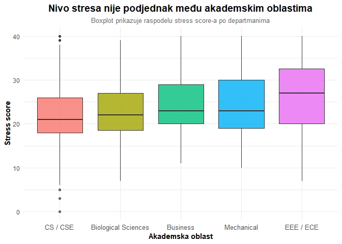
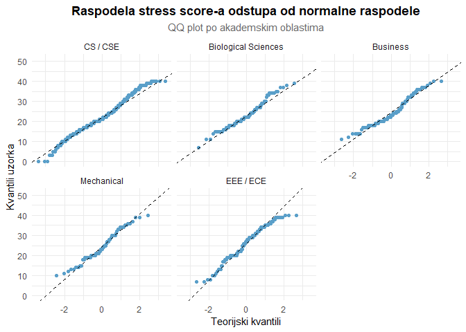
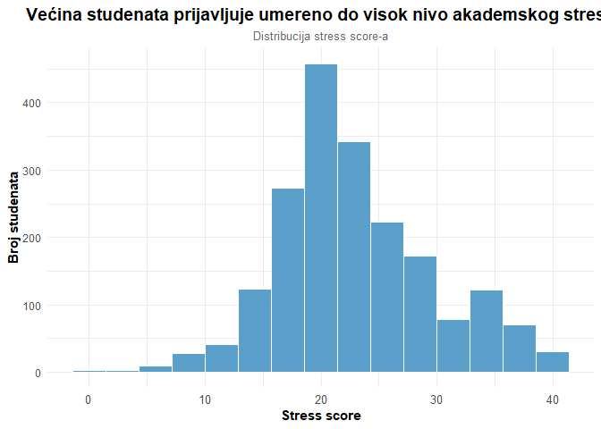
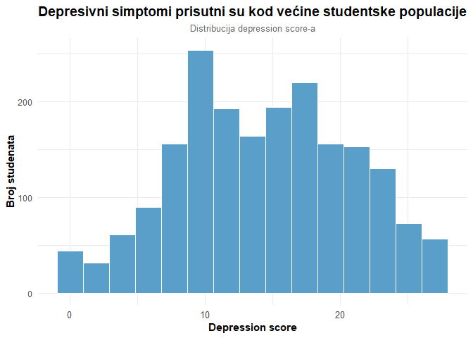
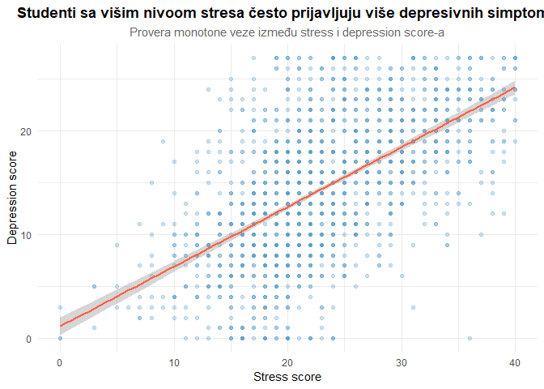
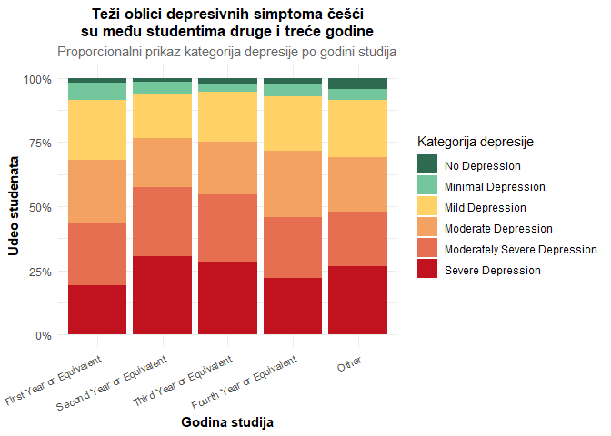

Analitika i vizualizacija podataka 2026 - Domaći 2
================
Katarina Gordić 41/2023 RN
2026-06-03

# **Povezanost akademskih faktora i mentalnog zdravlja kod studenata**

## **Uvod**

Za potrebe ovog domaćeg zadatka korišćen je dataset Bangladeshi
University Students Mental Health Dataset, preuzet sa platforme Kaggle.
Dataset sadrži podatke prikupljene anketom među studentima univerziteta
u Bangladešu tokom 2023. godine, sa ciljem istraživanja mentalnog
zdravlja studenata i faktora koji mogu biti povezani sa stresom,
anksioznošću i depresijom. Skup podataka obuhvata 1977 ispitanika i
uključuje demografske informacije, akademske podatke i rezultate
različitih psiholoških skala.

Mentalno zdravlje studenata procenjivano je pomoću više anketnih pitanja
organizovanih u skale za anksioznost, stres i depresiju. Na svako
pitanje ispitanici su odgovarali korišćenjem Likertove skale
učestalosti, nakon čega su odgovori objedinjeni u ukupne skorove
(Anxiety Value, Stress Value i Depression Value) koji predstavljaju
intenzitet simptoma u svakoj od posmatranih oblasti.

U okviru analize postavljena su sledeća istraživačka pitanja:

- Da li se nivo stresa razlikuje između različitih akademskih oblasti?
- Da li studenti sa višim nivoom stresa imaju i viši nivo depresije?
- Da li je kategorija depresije povezana sa godinom studija?

Ova pitanja su zanimljiva jer povezuju mentalno zdravlje studenata sa
akademskim faktorima kao što su oblast studija, uspeh na fakultetu i
godina studiranja. Tema je posebno značajna zbog sve većeg interesovanja
za uticaj akademskog pritiska na psihološko stanje studenata, kao i zbog
potencijalnog uticaja mentalnog zdravlja na kvalitet života i obrazovne
rezultate. Mentalno zdravlje predstavlja veoma važnu društvenu temu o
kojoj se i dalje ne govori dovoljno otvoreno, posebno među mladima i
studentima koji su često izloženi stresu, pritisku i očekivanjima
okoline. Zbog toga je važno analizirati ove podatke i bolje razumeti
faktore koji mogu doprineti pojavi stresa, anksioznosti i depresije kod
studenata.

## Priprema podataka

``` r
# ucitavanje
data <- read_csv("data/Raw Data.csv",show_col_types = FALSE)
```

``` r
# dimenzije
dim(data)
```

    ## [1] 1977   39

``` r
# kolone
names(data)
```

    ##  [1] "1. Age"                                                                                                                                                              
    ##  [2] "2. Gender"                                                                                                                                                           
    ##  [3] "3. University"                                                                                                                                                       
    ##  [4] "4. Department"                                                                                                                                                       
    ##  [5] "5. Academic Year"                                                                                                                                                    
    ##  [6] "6. Current CGPA"                                                                                                                                                     
    ##  [7] "7. Did you receive a waiver or scholarship at your university?"                                                                                                      
    ##  [8] "1. In a semester, how often you felt nervous, anxious or on edge due to academic pressure?"                                                                          
    ##  [9] "2. In a semester, how often have you been unable to stop worrying about your academic affairs?"                                                                      
    ## [10] "3. In a semester, how often have you had trouble relaxing due to academic pressure?"                                                                                 
    ## [11] "4. In a semester, how often have you been easily annoyed or irritated because of academic pressure?"                                                                 
    ## [12] "5. In a semester, how often have you worried too much about academic affairs?"                                                                                       
    ## [13] "6. In a semester, how often have you been so restless due to academic pressure that it is hard to sit still?"                                                        
    ## [14] "7. In a semester, how often have you felt afraid, as if something awful might happen?"                                                                               
    ## [15] "Anxiety Value"                                                                                                                                                       
    ## [16] "Anxiety Label"                                                                                                                                                       
    ## [17] "1. In a semester, how often have you felt upset due to something that happened in your academic affairs?"                                                            
    ## [18] "2. In a semester, how often you felt as if you were unable to control important things in your academic affairs?"                                                    
    ## [19] "3. In a semester, how often you felt nervous and stressed because of academic pressure?"                                                                             
    ## [20] "4. In a semester, how often you felt as if you could not cope with all the mandatory academic activities? (e.g, assignments, quiz, exams)"                           
    ## [21] "5. In a semester, how often you felt confident about your ability to handle your academic / university problems?"                                                    
    ## [22] "6. In a semester, how often you felt as if things in your academic life is going on your way?"                                                                       
    ## [23] "7. In a semester, how often are you able to control irritations in your academic / university affairs?"                                                              
    ## [24] "8. In a semester, how often you felt as if your academic performance was on top?"                                                                                    
    ## [25] "9. In a semester, how often you got angered due to bad performance or low grades that is beyond your control?"                                                       
    ## [26] "10. In a semester, how often you felt as if academic difficulties are piling up so high that you could not overcome them?"                                           
    ## [27] "Stress Value"                                                                                                                                                        
    ## [28] "Stress Label"                                                                                                                                                        
    ## [29] "1. In a semester, how often have you had little interest or pleasure in doing things?"                                                                               
    ## [30] "2. In a semester, how often have you been feeling down, depressed or hopeless?"                                                                                      
    ## [31] "3. In a semester, how often have you had trouble falling or staying asleep, or sleeping too much?"                                                                   
    ## [32] "4. In a semester, how often have you been feeling tired or having little energy?"                                                                                    
    ## [33] "5. In a semester, how often have you had poor appetite or overeating?"                                                                                               
    ## [34] "6. In a semester, how often have you been feeling bad about yourself - or that you are a failure or have let yourself or your family down?"                          
    ## [35] "7. In a semester, how often have you been having trouble concentrating on things, such as reading the books or watching television?"                                 
    ## [36] "8. In a semester, how often have you moved or spoke too slowly for other people to notice? Or you've been moving a lot more than usual because you've been restless?"
    ## [37] "9. In a semester, how often have you had thoughts that you would be better off dead, or of hurting yourself?"                                                        
    ## [38] "Depression Value"                                                                                                                                                    
    ## [39] "Depression Label"

``` r
summary(data)
```

    ##     1. Age           2. Gender         3. University      4. Department     
    ##  Length:1977        Length:1977        Length:1977        Length:1977       
    ##  Class :character   Class :character   Class :character   Class :character  
    ##  Mode  :character   Mode  :character   Mode  :character   Mode  :character  
    ##                                                                             
    ##                                                                             
    ##                                                                             
    ##  5. Academic Year   6. Current CGPA   
    ##  Length:1977        Length:1977       
    ##  Class :character   Class :character  
    ##  Mode  :character   Mode  :character  
    ##                                       
    ##                                       
    ##                                       
    ##  7. Did you receive a waiver or scholarship at your university?
    ##  Length:1977                                                   
    ##  Class :character                                              
    ##  Mode  :character                                              
    ##                                                                
    ##                                                                
    ##                                                                
    ##  1. In a semester, how often you felt nervous, anxious or on edge due to academic pressure?
    ##  Min.   :0.00                                                                              
    ##  1st Qu.:1.00                                                                              
    ##  Median :2.00                                                                              
    ##  Mean   :1.77                                                                              
    ##  3rd Qu.:3.00                                                                              
    ##  Max.   :3.00                                                                              
    ##  2. In a semester, how often have you been unable to stop worrying about your academic affairs?
    ##  Min.   :0.000                                                                                 
    ##  1st Qu.:1.000                                                                                 
    ##  Median :2.000                                                                                 
    ##  Mean   :1.629                                                                                 
    ##  3rd Qu.:3.000                                                                                 
    ##  Max.   :3.000                                                                                 
    ##  3. In a semester, how often have you had trouble relaxing due to academic pressure?
    ##  Min.   :0.000                                                                      
    ##  1st Qu.:1.000                                                                      
    ##  Median :2.000                                                                      
    ##  Mean   :1.747                                                                      
    ##  3rd Qu.:3.000                                                                      
    ##  Max.   :3.000                                                                      
    ##  4. In a semester, how often have you been easily annoyed or irritated because of academic pressure?
    ##  Min.   :0.000                                                                                      
    ##  1st Qu.:1.000                                                                                      
    ##  Median :2.000                                                                                      
    ##  Mean   :1.777                                                                                      
    ##  3rd Qu.:3.000                                                                                      
    ##  Max.   :3.000                                                                                      
    ##  5. In a semester, how often have you worried too much about academic affairs?
    ##  Min.   :0.000                                                                
    ##  1st Qu.:1.000                                                                
    ##  Median :2.000                                                                
    ##  Mean   :1.859                                                                
    ##  3rd Qu.:3.000                                                                
    ##  Max.   :3.000                                                                
    ##  6. In a semester, how often have you been so restless due to academic pressure that it is hard to sit still?
    ##  Min.   :0.000                                                                                               
    ##  1st Qu.:1.000                                                                                               
    ##  Median :2.000                                                                                               
    ##  Mean   :1.788                                                                                               
    ##  3rd Qu.:3.000                                                                                               
    ##  Max.   :3.000                                                                                               
    ##  7. In a semester, how often have you felt afraid, as if something awful might happen?
    ##  Min.   :0.00                                                                         
    ##  1st Qu.:1.00                                                                         
    ##  Median :2.00                                                                         
    ##  Mean   :1.72                                                                         
    ##  3rd Qu.:3.00                                                                         
    ##  Max.   :3.00                                                                         
    ##  Anxiety Value   Anxiety Label     
    ##  Min.   : 0.00   Length:1977       
    ##  1st Qu.: 8.00   Class :character  
    ##  Median :13.00   Mode  :character  
    ##  Mean   :12.29                     
    ##  3rd Qu.:17.00                     
    ##  Max.   :21.00                     
    ##  1. In a semester, how often have you felt upset due to something that happened in your academic affairs?
    ##  Min.   :0.000                                                                                           
    ##  1st Qu.:2.000                                                                                           
    ##  Median :2.000                                                                                           
    ##  Mean   :2.342                                                                                           
    ##  3rd Qu.:3.000                                                                                           
    ##  Max.   :4.000                                                                                           
    ##  2. In a semester, how often you felt as if you were unable to control important things in your academic affairs?
    ##  Min.   :0.00                                                                                                    
    ##  1st Qu.:2.00                                                                                                    
    ##  Median :2.00                                                                                                    
    ##  Mean   :2.32                                                                                                    
    ##  3rd Qu.:3.00                                                                                                    
    ##  Max.   :4.00                                                                                                    
    ##  3. In a semester, how often you felt nervous and stressed because of academic pressure?
    ##  Min.   :0.000                                                                          
    ##  1st Qu.:2.000                                                                          
    ##  Median :3.000                                                                          
    ##  Mean   :2.706                                                                          
    ##  3rd Qu.:4.000                                                                          
    ##  Max.   :4.000                                                                          
    ##  4. In a semester, how often you felt as if you could not cope with all the mandatory academic activities? (e.g, assignments, quiz, exams)
    ##  Min.   :0.000                                                                                                                            
    ##  1st Qu.:2.000                                                                                                                            
    ##  Median :2.000                                                                                                                            
    ##  Mean   :2.361                                                                                                                            
    ##  3rd Qu.:3.000                                                                                                                            
    ##  Max.   :4.000                                                                                                                            
    ##  5. In a semester, how often you felt confident about your ability to handle your academic / university problems?
    ##  Min.   :0.000                                                                                                   
    ##  1st Qu.:1.000                                                                                                   
    ##  Median :2.000                                                                                                   
    ##  Mean   :1.825                                                                                                   
    ##  3rd Qu.:2.000                                                                                                   
    ##  Max.   :4.000                                                                                                   
    ##  6. In a semester, how often you felt as if things in your academic life is going on your way?
    ##  Min.   :0.00                                                                                 
    ##  1st Qu.:2.00                                                                                 
    ##  Median :2.00                                                                                 
    ##  Mean   :2.21                                                                                 
    ##  3rd Qu.:3.00                                                                                 
    ##  Max.   :4.00                                                                                 
    ##  7. In a semester, how often are you able to control irritations in your academic / university affairs?
    ##  Min.   :0.000                                                                                         
    ##  1st Qu.:2.000                                                                                         
    ##  Median :2.000                                                                                         
    ##  Mean   :2.071                                                                                         
    ##  3rd Qu.:3.000                                                                                         
    ##  Max.   :4.000                                                                                         
    ##  8. In a semester, how often you felt as if your academic performance was on top?
    ##  Min.   :0.000                                                                   
    ##  1st Qu.:2.000                                                                   
    ##  Median :2.000                                                                   
    ##  Mean   :2.276                                                                   
    ##  3rd Qu.:3.000                                                                   
    ##  Max.   :4.000                                                                   
    ##  9. In a semester, how often you got angered due to bad performance or low grades that is beyond your control?
    ##  Min.   :0.000                                                                                                
    ##  1st Qu.:2.000                                                                                                
    ##  Median :2.000                                                                                                
    ##  Mean   :2.419                                                                                                
    ##  3rd Qu.:3.000                                                                                                
    ##  Max.   :4.000                                                                                                
    ##  10. In a semester, how often you felt as if academic difficulties are piling up so high that you could not overcome them?
    ##  Min.   :0.000                                                                                                            
    ##  1st Qu.:2.000                                                                                                            
    ##  Median :2.000                                                                                                            
    ##  Mean   :2.433                                                                                                            
    ##  3rd Qu.:3.000                                                                                                            
    ##  Max.   :4.000                                                                                                            
    ##   Stress Value   Stress Label      
    ##  Min.   : 0.00   Length:1977       
    ##  1st Qu.:19.00   Class :character  
    ##  Median :22.00   Mode  :character  
    ##  Mean   :22.96                     
    ##  3rd Qu.:27.00                     
    ##  Max.   :40.00                     
    ##  1. In a semester, how often have you had little interest or pleasure in doing things?
    ##  Min.   :0.000                                                                        
    ##  1st Qu.:1.000                                                                        
    ##  Median :1.000                                                                        
    ##  Mean   :1.461                                                                        
    ##  3rd Qu.:2.000                                                                        
    ##  Max.   :3.000                                                                        
    ##  2. In a semester, how often have you been feeling down, depressed or hopeless?
    ##  Min.   :0.000                                                                 
    ##  1st Qu.:1.000                                                                 
    ##  Median :2.000                                                                 
    ##  Mean   :1.788                                                                 
    ##  3rd Qu.:3.000                                                                 
    ##  Max.   :3.000                                                                 
    ##  3. In a semester, how often have you had trouble falling or staying asleep, or sleeping too much?
    ##  Min.   :0.000                                                                                    
    ##  1st Qu.:1.000                                                                                    
    ##  Median :2.000                                                                                    
    ##  Mean   :1.657                                                                                    
    ##  3rd Qu.:3.000                                                                                    
    ##  Max.   :3.000                                                                                    
    ##  4. In a semester, how often have you been feeling tired or having little energy?
    ##  Min.   :0.000                                                                   
    ##  1st Qu.:1.000                                                                   
    ##  Median :2.000                                                                   
    ##  Mean   :1.959                                                                   
    ##  3rd Qu.:3.000                                                                   
    ##  Max.   :3.000                                                                   
    ##  5. In a semester, how often have you had poor appetite or overeating?
    ##  Min.   :0.000                                                        
    ##  1st Qu.:1.000                                                        
    ##  Median :1.000                                                        
    ##  Mean   :1.504                                                        
    ##  3rd Qu.:2.000                                                        
    ##  Max.   :3.000                                                        
    ##  6. In a semester, how often have you been feeling bad about yourself - or that you are a failure or have let yourself or your family down?
    ##  Min.   :0.000                                                                                                                             
    ##  1st Qu.:1.000                                                                                                                             
    ##  Median :2.000                                                                                                                             
    ##  Mean   :1.782                                                                                                                             
    ##  3rd Qu.:3.000                                                                                                                             
    ##  Max.   :3.000                                                                                                                             
    ##  7. In a semester, how often have you been having trouble concentrating on things, such as reading the books or watching television?
    ##  Min.   :0.000                                                                                                                      
    ##  1st Qu.:1.000                                                                                                                      
    ##  Median :2.000                                                                                                                      
    ##  Mean   :1.636                                                                                                                      
    ##  3rd Qu.:3.000                                                                                                                      
    ##  Max.   :3.000                                                                                                                      
    ##  8. In a semester, how often have you moved or spoke too slowly for other people to notice? Or you've been moving a lot more than usual because you've been restless?
    ##  Min.   :0.000                                                                                                                                                       
    ##  1st Qu.:1.000                                                                                                                                                       
    ##  Median :1.000                                                                                                                                                       
    ##  Mean   :1.426                                                                                                                                                       
    ##  3rd Qu.:2.000                                                                                                                                                       
    ##  Max.   :3.000                                                                                                                                                       
    ##  9. In a semester, how often have you had thoughts that you would be better off dead, or of hurting yourself?
    ##  Min.   :0.000                                                                                               
    ##  1st Qu.:0.000                                                                                               
    ##  Median :1.000                                                                                               
    ##  Mean   :1.162                                                                                               
    ##  3rd Qu.:2.000                                                                                               
    ##  Max.   :3.000                                                                                               
    ##  Depression Value Depression Label  
    ##  Min.   : 0.00    Length:1977       
    ##  1st Qu.: 9.00    Class :character  
    ##  Median :14.00    Mode  :character  
    ##  Mean   :14.37                      
    ##  3rd Qu.:19.00                      
    ##  Max.   :27.00

``` r
# provera NA vrednosti
sum(is.na(data))
```

    ## [1] 0

``` r
table(data$`4. Department`)
```

    ## 
    ##                                  Biological Sciences 
    ##                                                   95 
    ##                Business and Entrepreneurship Studies 
    ##                                                  129 
    ##      Engineering - Civil Engineering / Similar to CE 
    ##                                                   50 
    ##         Engineering - CS / CSE / CSC / Similar to CS 
    ##                                                 1377 
    ##              Engineering - EEE/ ECE / Similar to EEE 
    ##                                                  127 
    ## Engineering - Mechanical Engineering / Similar to ME 
    ##                                                   68 
    ##                                  Engineering - Other 
    ##                                                    4 
    ##                      Environmental and Life Sciences 
    ##                                                   47 
    ##                                 Law and Human Rights 
    ##                                                    1 
    ##                     Liberal Arts and Social Sciences 
    ##                                                    1 
    ##                                                Other 
    ##                                                   77 
    ##                           Pharmacy and Public Health 
    ##                                                    1

``` r
table(data$`5. Academic Year`)
```

    ## 
    ##  First Year or Equivalent Fourth Year or Equivalent                     Other 
    ##                       592                       392                        71 
    ## Second Year or Equivalent  Third Year or Equivalent 
    ##                       370                       552

``` r
table(data$`Anxiety Label`)
```

    ## 
    ##     Mild Anxiety  Minimal Anxiety Moderate Anxiety   Severe Anxiety 
    ##              495              158              610              714

``` r
table(data$`Stress Label`)
```

    ## 
    ## High Perceived Stress            Low Stress       Moderate Stress 
    ##                   546                   115                  1316

``` r
table(data$`Depression Label`)
```

    ## 
    ##              Mild Depression           Minimal Depression 
    ##                          408                           93 
    ##          Moderate Depression Moderately Severe Depression 
    ##                          449                          495 
    ##                No Depression            Severe Depression 
    ##                           44                          488

``` r
table(data$`6. Current CGPA`)
```

    ## 
    ## 2.50 - 2.99 3.00 - 3.39 3.40 - 3.79 3.80 - 4.00  Below 2.50       Other 
    ##         368         572         551         237          81         168

Zbog veoma malog broja ispitanika u pojedinim akademskim oblastima,
određeni departmani nisu uključeni u analizu po oblastima studija. Na
taj način izbegnut je uticaj ekstremno malih grupa na rezultate
statističkih testova i omogućena je pouzdanija interpretacija rezultata.

``` r
filtered_data <- data %>%
  filter(
    `4. Department` %in% c(
      "Biological Sciences",
      "Business and Entrepreneurship Studies",
      "Engineering - CS / CSE / CSC / Similar to CS",
      "Engineering - EEE/ ECE / Similar to EEE",
      "Engineering - Mechanical Engineering / Similar to ME"
    )
  )

# provera nakon filtriranja
table(filtered_data$`4. Department`)
```

    ## 
    ##                                  Biological Sciences 
    ##                                                   95 
    ##                Business and Entrepreneurship Studies 
    ##                                                  129 
    ##         Engineering - CS / CSE / CSC / Similar to CS 
    ##                                                 1377 
    ##              Engineering - EEE/ ECE / Similar to EEE 
    ##                                                  127 
    ## Engineering - Mechanical Engineering / Similar to ME 
    ##                                                   68

## **Pitanje 1**

## Da li se nivo stresa razlikuje između različitih akademskih oblasti?

``` r
# box plot
plot_data <- filtered_data %>%
  mutate(
    department_short = recode(
      `4. Department`,
      "Biological Sciences" = "Biological Sciences",
      "Business and Entrepreneurship Studies" = "Business",
      "Engineering - CS / CSE / CSC / Similar to CS" = "CS / CSE",
      "Engineering - EEE/ ECE / Similar to EEE" = "EEE / ECE",
      "Engineering - Mechanical Engineering / Similar to ME" = "Mechanical"
    )
  ) %>%
  mutate(
    department_short = reorder(department_short,
                               `Stress Value`,
                               median)
  )

ggplot(plot_data,
       aes(x = department_short,
           y = `Stress Value`,
           fill = department_short)) +

  geom_boxplot(alpha = 0.8,
               outlier.alpha = 0.3) +

  labs(
    title = "Nivo stresa nije podjednak među akademskim oblastima",
    subtitle = "Boxplot prikazuje raspodelu stress score-a po departmanima",
    x = "Akademska oblast",
    y = "Stress score"
  ) +

  theme_minimal() +

  theme(
    legend.position = "none",

    plot.title = element_text(
      hjust = 0.5,
      face = "bold",
      size = 14
    ),

    plot.subtitle = element_text(
      hjust = 0.5,
      size = 10,
      color = "gray40"
    ),

    axis.title.x = element_text(face = "bold"),
    axis.title.y = element_text(face = "bold"),

    axis.text.x = element_text(size = 10)
  )
```

<!-- -->

Na osnovu boxplot grafika mogu se uočiti razlike u raspodeli nivoa
stresa između akademskih oblasti. Studenti iz EEE/ECE oblasti imaju
najvišu medijanu stress score-a i generalno više vrednosti stresa u
odnosu na ostale grupe, dok studenti iz CS/CSE oblasti pokazuju najniže
vrednosti. Takođe se primećuje prisustvo nekoliko ekstremnih vrednosti,
posebno u CS/CSE grupi.

### Shapiro-Wilk test

``` r
plot_data %>%
  group_by(department_short) %>%
  summarise(
    shapiro_p = shapiro.test(`Stress Value`)$p.value
  )
```

    ## # A tibble: 5 × 2
    ##   department_short    shapiro_p
    ##   <fct>                   <dbl>
    ## 1 CS / CSE             7.32e-13
    ## 2 Biological Sciences  3.60e- 2
    ## 3 Business             1.62e- 4
    ## 4 Mechanical           7.34e- 2
    ## 5 EEE / ECE            6.37e- 3

### QQ plot

``` r
ggplot(plot_data,
       aes(sample = `Stress Value`)) +

  stat_qq(color = "#5a9fc9") +

  stat_qq_line(
    color = "black",
    linetype = "dashed"
  ) +

  facet_wrap(~department_short) +

  labs(
    title = "Raspodela stress score-a odstupa od normalne raspodele",
    subtitle = "QQ plot po akademskim oblastima",
    x = "Teorijski kvantili",
    y = "Kvantili uzorka"
  ) +

  theme_minimal() +

  theme(
    plot.title = element_text(
      hjust = 0.5,
      face = "bold"
    ),

    plot.subtitle = element_text(
      hjust = 0.5,
      color = "gray40"
    )
  )
```

<!-- -->

Rezultati Shapiro-Wilk testa i QQ plot grafici pokazuju da raspodela
stress score-a u većini akademskih oblasti odstupa od normalne
raspodele. Pošto pretpostavka normalnosti nije zadovoljena u većini
grupa, za poređenje oblasti korišćen je neparametarski Kruskal-Wallis
test koji ne zahteva normalnu raspodelu podataka.

### Kruskal-Wallis test

``` r
kruskal.test(
  `Stress Value` ~ department_short,
  data = plot_data
)
```

    ## 
    ##  Kruskal-Wallis rank sum test
    ## 
    ## data:  Stress Value by department_short
    ## Kruskal-Wallis chi-squared = 45.368, df = 4, p-value = 3.333e-09

Rezultati Kruskal-Wallis testa pokazali su da postoji statistički
značajna razlika u nivou stresa između različitih akademskih oblasti (p
\< 0.001). To ukazuje da studenti različitih oblasti studija ne
prijavljuju podjednak nivo akademskog stresa.

### Post-hoc test

``` r
dunnTest(
  `Stress Value` ~ department_short,
  data = plot_data,
  method = "bonferroni"
)
```

    ##                          Comparison          Z      P.unadj        P.adj
    ## 1    Biological Sciences - Business  0.3093911 7.570241e-01 1.000000e+00
    ## 2    Biological Sciences - CS / CSE  2.3438864 1.908398e-02 1.908398e-01
    ## 3               Business - CS / CSE  2.2460129 2.470318e-02 2.470318e-01
    ## 4   Biological Sciences - EEE / ECE -2.7422734 6.101554e-03 6.101554e-02
    ## 5              Business - EEE / ECE -3.3103964 9.316392e-04 9.316392e-03
    ## 6              CS / CSE - EEE / ECE -6.6922065 2.198303e-11 2.198303e-10
    ## 7  Biological Sciences - Mechanical  2.1686352 3.011039e-02 3.011039e-01
    ## 8             Business - Mechanical  2.0195689 4.342812e-02 4.342812e-01
    ## 9             CS / CSE - Mechanical  0.7715402 4.403868e-01 1.000000e+00
    ## 10           EEE / ECE - Mechanical  4.7679648 1.860963e-06 1.860963e-05

Post-hoc Dunn test pokazao je da se studenti iz EEE/ECE oblasti
statistički značajno razlikuju od više drugih grupa. Najizraženije
razlike uočene su između EEE/ECE i CS/CSE studenata, kao i između
EEE/ECE i Mechanical oblasti. Rezultati ukazuju da studenti EEE/ECE
oblasti prijavljuju više nivoe stresa u odnosu na pojedine druge
akademske oblasti.

### Zaključak

Na osnovu sprovedene analize može se zaključiti da nivo stresa nije
podjednak među akademskim oblastima. Studenti EEE/ECE oblasti
prijavljuju više nivoe stresa u poređenju sa pojedinim drugim grupama,
posebno studentima CS/CSE i Mechanical oblasti. Ovi rezultati sugerišu
da akademsko okruženje i priroda studijskog programa mogu biti povezani
sa načinom na koji studenti doživljavaju akademski pritisak i
opterećenje.

## **Pitanje 2**

## Da li studenti sa višim nivoom stresa imaju i viši nivo depresije?

``` r
# distribucija stress score-a
ggplot(data, aes(x = `Stress Value`)) +
  geom_histogram(
    bins = 15,
    fill = "#5a9fc9",
    color = "white"
  ) +
  labs(
    title = "Većina studenata prijavljuje umereno do visok nivo akademskog stresa",
    subtitle = "Distribucija stress score-a",
    x = "Stress score",
    y = "Broj studenata"
  ) +
  theme_minimal() +
  theme(
    legend.position = "none",

    plot.title = element_text(
      hjust = 0.5,
      face = "bold",
      size = 14
    ),

    plot.subtitle = element_text(
      hjust = 0.5,
      size = 10,
      color = "gray40"
    ),

    axis.title.x = element_text(face = "bold"),
    axis.title.y = element_text(face = "bold"),

    axis.text.x = element_text(size = 10)
  )
```

<!-- -->

``` r
# distribucija depression score-a
ggplot(data, aes(x = `Depression Value`)) +
  geom_histogram(
    bins = 15,
    fill = "#5a9fc9",
    color = "white"
  ) +
  labs(
    title = "Depresivni simptomi prisutni su kod većine studentske populacije",
    subtitle = "Distribucija depression score-a",
    x = "Depression score",
    y = "Broj studenata"
  ) +
  theme_minimal() +
  theme(
    legend.position = "none",

    plot.title = element_text(
      hjust = 0.5,
      face = "bold",
      size = 14
    ),

    plot.subtitle = element_text(
      hjust = 0.5,
      size = 10,
      color = "gray40"
    ),

    axis.title.x = element_text(face = "bold"),
    axis.title.y = element_text(face = "bold"),

    axis.text.x = element_text(size = 10)
  )
```

<!-- -->

Histogrami pokazuju da raspodele nisu idealno normalne

### Scatter plot

``` r
ggplot(data,
       aes(x = `Stress Value`,
           y = `Depression Value`)) +

  geom_point(
    alpha = 0.3,
    color = "#5a9fc9"
  ) +

  geom_smooth(
    method = "lm",
    color = "tomato",
    se = TRUE
  ) +

  labs(
    title = "Studenti sa višim nivoom stresa često prijavljuju više depresivnih simptoma",
    subtitle = "Provera monotone veze između stress i depression score-a",
    x = "Stress score",
    y = "Depression score"
  ) +

  theme_minimal() +

  theme(
    plot.title = element_text(
      hjust = 0.5,
      face = "bold"
    ),
    plot.subtitle = element_text(
      hjust = 0.5,
      color = "gray40"
    )
  )
```

<!-- -->

Na scatter plot grafiku uočava se jasan uzlazni trend. Studenti sa višim
vrednostima stress score-a uglavnom imaju i više vrednosti depression
score-a, što ukazuje na pozitivnu povezanost između akademskog stresa i
depresivnih simptoma.

Za ispitivanje povezanosti između nivoa stresa i nivoa depresivnih
simptoma korišćena je Spearman korelacija. Ovaj test je izabran jer
promenljive ne prate idealno normalnu raspodelu, a Spearman korelacija
ne zahteva pretpostavku normalnosti podataka. Takođe, pogodna je za
analizu monotone povezanosti između psiholoških skala dobijenih anketnim
putem.

### Spearman korelacija

``` r
cor.test(
  data$`Stress Value`,
  data$`Depression Value`,
  method = "spearman"
)
```

    ## 
    ##  Spearman's rank correlation rho
    ## 
    ## data:  data$`Stress Value` and data$`Depression Value`
    ## S = 526256385, p-value < 2.2e-16
    ## alternative hypothesis: true rho is not equal to 0
    ## sample estimates:
    ##       rho 
    ## 0.5913714

Rezultati Spearman korelacije pokazali su umereno jaku pozitivnu
povezanost između nivoa stresa i nivoa depresivnih simptoma (ρ = 0.591,
p \< 0.001). To znači da studenti koji prijavljuju viši nivo akademskog
stresa često prijavljuju i više depresivnih simptoma. Dobijena
povezanost je dovoljno izražena da se ne može objasniti slučajnim
varijacijama u uzorku. Ipak, korelacija nije savršena — postoje studenti
koji prijavljuju visok stres bez izraženih depresivnih simptoma, što
sugeriše da i drugi faktori igraju ulogu u razvoju depresije.

### Zaključak

Rezultati analize pokazuju da studenti koji prijavljuju viši nivo
akademskog stresa često prijavljuju i više depresivnih simptoma. Drugim
rečima, kako raste osećaj akademskog opterećenja i pritiska, raste i
verovatnoća da studenti iskazuju znakove lošijeg psihološkog stanja.
Iako ova analiza ne može dokazati da stres direktno izaziva depresiju,
rezultati ukazuju da su ova dva aspekta mentalnog zdravlja usko povezana
među studentima.

## **Pitanje 3**

## Da li je kategorija depresije povezana sa godinom studija?

``` r
depression_boje <- c(
  "No Depression" = "#2d6a4f",
  "Minimal Depression" = "#74c69d",
  "Mild Depression" = "#ffd166",
  "Moderate Depression" = "#f4a261",
  "Moderately Severe Depression" = "#e76f51",
  "Severe Depression" = "#c1121f"
)

depression_redosled <- c(
  "No Depression",
  "Minimal Depression", 
  "Mild Depression",
  "Moderate Depression",
  "Moderately Severe Depression",
  "Severe Depression"
)

year_redosled <- c(
  "First Year or Equivalent",
  "Second Year or Equivalent", 
  "Third Year or Equivalent",
  "Fourth Year or Equivalent",
  "Other"
)

data$`5. Academic Year` <- factor(data$`5. Academic Year`, levels = year_redosled)
data$`Depression Label` <- factor(data$`Depression Label`, levels = depression_redosled)

ggplot(data, aes(x = `5. Academic Year`, fill = `Depression Label`)) +
  geom_bar(position = "fill") +
  scale_y_continuous(labels = scales::percent) +
  scale_fill_manual(values = depression_boje) +
  labs(
    title = "Teži oblici depresivnih simptoma češći\nsu među studentima druge i treće godine",
    subtitle = "Proporcionalni prikaz kategorija depresije po godini studija",
    x = "Godina studija",
    y = "Udeo studenata",
    fill = "Kategorija depresije"
  ) +
  theme_minimal() +
  theme(
    plot.title = element_text(hjust = 0.5, face = "bold", size = 13),
    plot.subtitle = element_text(hjust = 0.5, color = "gray40"),
    axis.title.x = element_text(face = "bold"),
    axis.title.y = element_text(face = "bold"),
    axis.text.x = element_text(size = 8, angle = 25, hjust = 1)
  )
```

<!-- -->

Grafik prikazuje raspodelu kategorija depresije unutar različitih godina
studija. Na prvi pogled raspodele deluju relativno slične, ali se mogu
uočiti određene razlike. Posebno se primećuje nešto veći udeo težih
kategorija depresije kod studenata druge i treće godine, dok studenti
prve godine imaju nešto veći udeo blažih kategorija depresije.

### Provera očekivanih frekvencija

``` r
# provera pretpostavki - ocekivane frekvencije
chisq_table <- table(data$`Depression Label`, data$`5. Academic Year`)

round(chisq.test(chisq_table)$expected,2)
```

    ##                               
    ##                                First Year or Equivalent
    ##   No Depression                                   13.18
    ##   Minimal Depression                              27.85
    ##   Mild Depression                                122.17
    ##   Moderate Depression                            134.45
    ##   Moderately Severe Depression                   148.22
    ##   Severe Depression                              146.13
    ##                               
    ##                                Second Year or Equivalent
    ##   No Depression                                     8.23
    ##   Minimal Depression                               17.41
    ##   Mild Depression                                  76.36
    ##   Moderate Depression                              84.03
    ##   Moderately Severe Depression                     92.64
    ##   Severe Depression                                91.33
    ##                               
    ##                                Third Year or Equivalent
    ##   No Depression                                   12.29
    ##   Minimal Depression                              25.97
    ##   Mild Depression                                113.92
    ##   Moderate Depression                            125.37
    ##   Moderately Severe Depression                   138.21
    ##   Severe Depression                              136.25
    ##                               
    ##                                Fourth Year or Equivalent Other
    ##   No Depression                                     8.72  1.58
    ##   Minimal Depression                               18.44  3.34
    ##   Mild Depression                                  80.90 14.65
    ##   Moderate Depression                              89.03 16.12
    ##   Moderately Severe Depression                     98.15 17.78
    ##   Severe Depression                                96.76 17.53

Provera očekivanih frekvencija pokazuje da su gotovo sve ćelije iznad
minimalne vrednosti 5, uz dva izuzetka u grupi “Other” — kategorije “No
Depression” i “Minimal Depression”. Budući da su samo 2 od 30 ćelija
ispod praga, pretpostavke hi-kvadrat testa su zadovoljene u dovoljnoj
meri da se sprovede test.

### hi-kvadrat test

``` r
chi <- chisq.test(chisq_table)
chi
```

    ## 
    ##  Pearson's Chi-squared test
    ## 
    ## data:  chisq_table
    ## X-squared = 41.726, df = 20, p-value = 0.003002

Rezultati hi-kvadrat testa pokazali su da raspodela kategorija depresije
nije ista u svim godinama studija (χ² = 41.73, p = 0.003). To ukazuje da
postoji povezanost između godine studija i učestalosti različitih
kategorija depresije među studentima.

### Analiza reziduala

``` r
round(chi$residuals, 2)
```

    ##                               
    ##                                First Year or Equivalent
    ##   No Depression                                   -0.32
    ##   Minimal Depression                               1.92
    ##   Mild Depression                                  1.43
    ##   Moderate Depression                              1.17
    ##   Moderately Severe Depression                    -0.51
    ##   Severe Depression                               -2.66
    ##                               
    ##                                Second Year or Equivalent
    ##   No Depression                                    -0.78
    ##   Minimal Depression                                0.14
    ##   Mild Depression                                  -1.53
    ##   Moderate Depression                              -1.42
    ##   Moderately Severe Depression                      0.66
    ##   Severe Depression                                 2.27
    ##                               
    ##                                Third Year or Equivalent
    ##   No Depression                                    0.77
    ##   Minimal Depression                              -2.35
    ##   Mild Depression                                 -0.55
    ##   Moderate Depression                             -1.10
    ##   Moderately Severe Depression                     0.66
    ##   Severe Depression                                1.69
    ##                               
    ##                                Fourth Year or Equivalent Other
    ##   No Depression                                    -0.25  1.13
    ##   Minimal Depression                                0.36 -0.19
    ##   Mild Depression                                   0.23  0.35
    ##   Moderate Depression                               1.37 -0.28
    ##   Moderately Severe Depression                     -0.52 -0.66
    ##   Severe Depression                                -1.09  0.35

Analiza reziduala pokazuje da ukupna povezanost između godine studija i
kategorije depresije najviše potiče od nekoliko specifičnih grupa. -
Studenti prve godine češće nego što bi se očekivalo pripadaju kategoriji
minimalne depresije, a ređe kategoriji teške depresije. - Sa druge
strane, studenti druge godine češće pripadaju kategoriji teške
depresije. - Takođe, studenti treće godine ređe nego što bi se očekivalo
pripadaju kategoriji minimalne depresije. Ovi obrasci ukazuju da
raspodela depresivnih simptoma nije potpuno ista tokom svih godina
studiranja.

### Zaključak

Na osnovu sprovedene analize može se zaključiti da se obrasci
depresivnih simptoma menjaju tokom studiranja. Rezultati ukazuju da se
najnepovoljnija slika mentalnog zdravlja javlja tokom sredine studija,
dok studenti prve godine pokazuju nešto blaže simptome, a kod studenata
završnih godina uočava se blago smanjenje udela najtežih kategorija
depresije. Ovakav obrazac sugeriše da period nakon prilagođavanja na
fakultetu, ali pre završetka studija, može predstavljati psihološki
najzahtevniju fazu studiranja.

## **Sinteza**

Sve tri analize ukazuju da mentalno zdravlje studenata nije nezavisno od
njihovog akademskog okruženja i iskustva studiranja. Prva analiza
pokazala je da se nivo akademskog stresa razlikuje između pojedinih
akademskih oblasti, pri čemu studenti EEE (Electrical and Electronics
Engineering) i ECE (Electronics and Communication Engineering) oblasti
prijavljuju više nivoe stresa u odnosu na neke druge oblasti. Druga
analiza pokazala je umereno jaku pozitivnu povezanost između stresa i
depresivnih simptoma, što ukazuje da studenti sa višim nivoom akademskog
stresa često prijavljuju i više depresivnih simptoma. Treća analiza
pokazala je da raspodela depresivnih simptoma nije ista tokom svih
godina studija, pri čemu se najnepovoljnija slika mentalnog zdravlja
uočava kod studenata srednjih godina studija.

Najinformativnija analiza bila je Spearman korelacija između nivoa
stresa i nivoa depresivnih simptoma. Dok su prve i treća analiza
pokazale razlike između grupa studenata, korelaciona analiza je otkrila
direktnu povezanost između dva ključna pokazatelja mentalnog zdravlja.
Rezultati sugerišu da studenti koji doživljavaju veći akademski pritisak
češće prijavljuju i izraženije depresivne simptome, što predstavlja
najjasniji obrazac u celom skupu podataka.

Jedno od ograničenja ove analize jeste činjenica da su korišćene
vrednosti (scores) izvedeni iz odgovora na anketna pitanja, pa rezultati
zavise od načina na koji su ispitanici procenjivali i prijavljivali
sopstvena iskustva. Pored toga, sprovedene analize mogu pokazati
povezanost između promenljivih, ali ne i uzročno-posledične odnose. Na
primer, nije moguće zaključiti da akademski stres direktno izaziva
depresivne simptome, niti da su razlike između godina studija ili
akademskih oblasti jedini faktori koji utiču na mentalno zdravlje
studenata.
